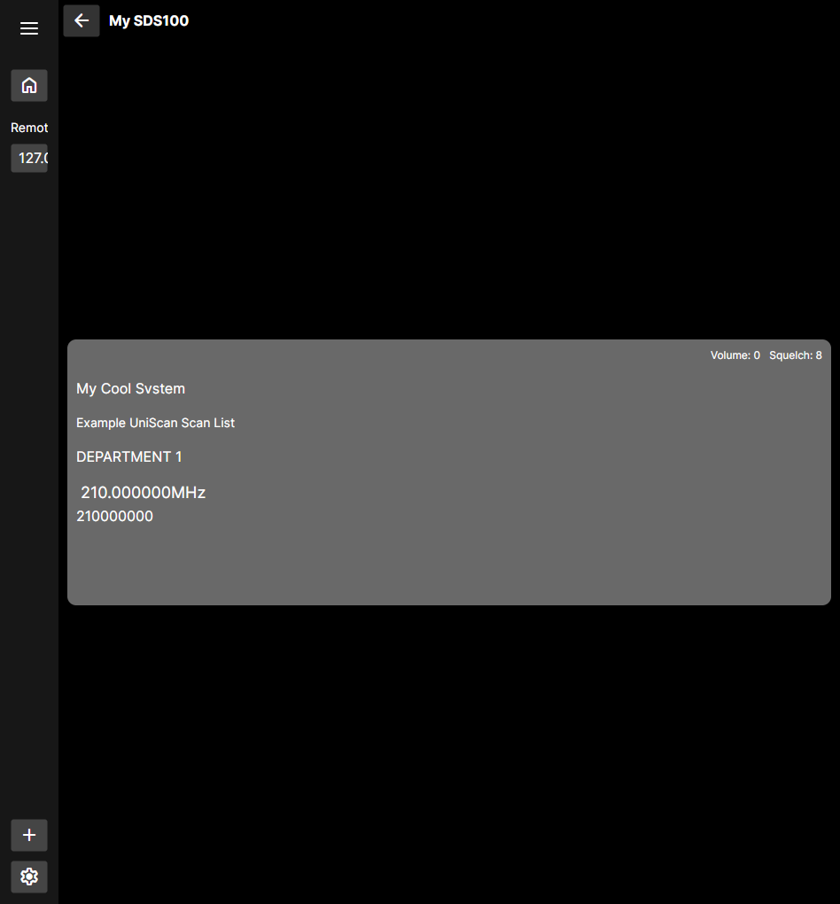
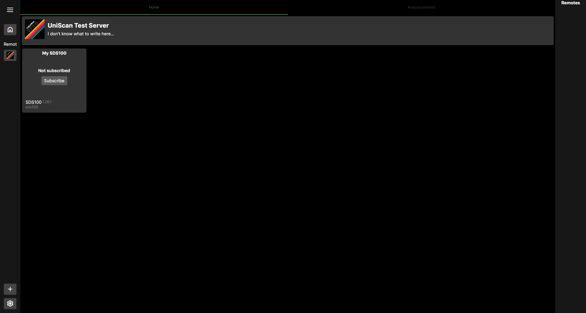

<h1 style="padding-top: 0;">UniScan</h1>

Modular, cross-platform scanner/radio client and multi-broadcast server. Plug in a scanner, set it up in the server software, and open
it up to the internet for others to listen to, and control it yourself by logging into an admin user.

Modular meaning that custom built modules will be able to fully extend the client and server via hooks, event listening, configuration stages, and more all without requiring e.g. Harmony hooks for most simple extension needs.

The client works by connecting to a "Remote", which contains devices that the client can 'subscribe' to receive updates, see current scanning info, and (soon) listen to any device's configured audio track(s).

Remotes require a plugin that adds support for whatever devices plan to be connected, with device pages being rendered on the serverside and sent to the client.
This allows the client to not require too much special setup to communicate with virtually any Remote.

In the future, there will be easy ways for hosters to embed the UniScan client in their website with a preset configuration to automatically add and connect to their server(s).

<table>
  <tr>
    <td align="center" width="33%">
      
       
      <b>UniScan receiving and displaying data from a remote SDS100</b>
    </td>
    <td align="center" width="33%">
      
       
      <b>UniScan connected to a "remote" that has one device</b>
    </td>
  </tr>
</table>

### Roadmap
Our full roadmap can be viewed on our [GitHub Project](https://github.com/orgs/UniScanProject/projects/2)

#### (rough) Feature roadmap
- [X] Module support
- Official Extension Modules
  - [ ] Virtual Scanner debug module
  - [ ] Transcript module (via some STT model)
  
##### Server
- [X] Modular custom scanner support framework
- [X] Networking
- [X] Support for multiple network hosting methods (TCP, Websocket (via module))
- [X] Serverside rendering of scanner info to send to the client
- [ ] Serverside rendering of server,serverside plugin options to send to the client
- [ ] Serverside rendering of a scanner's display to send to the client
- [ ] Custom serverside rendered pages to send to the Client
- [ ] Scanner audio track streaming
  - By audio track, I mean having multiple audio tracks, since I believe some radio devices can have multiple outputs? I don't fully know yet.
  - Either way, no reason to not have multiple.
- [ ] Users and Authentication
- [ ] Announcement posting from users
- [ ] Remote scanner management from users with the correct permissions
- [ ] Scanner programming (may not happen)

##### Client
- [X] Connecting to remotes
- [X] Displaying remote info (name,description,links,logo,announcements,etc)
- [X] Displaying live device info (such as current channel, scan list, etc)
- [ ] Listening to audio tracks
- [ ] Input optimized UI
  - i.e. better UI for tv remotes,controllers on Android TV, better UI for narrow touchscreens on Android,iOS.
  - But all will be accessible crossplatform anyway
- [ ] Nicer theme
- [ ] User login
- [ ] Rendering of custom serverside rendered pages created by the server
- [ ] Internal server for connecting local scanners without the need for hosting

## Setup
UniScan currently supports Windows, macOS, Linux, Android, and iOS (kind of)
In addition to these platforms, UniScan can also run [entirely in your browser!](https://uniscan.dexrn.me)

> [!IMPORTANT]
> Browser support is currently broken due to some OPFS garbage, sorry.
>
> will fix soon hopefully.

Additionally, Android TV does work, but no optimized UI has been made as of now.

Below, you can learn how to setup and install UniScan for your platform.
#### Windows
- [Install .NET 10](https://dot.net/download)
- Download the latest Windows release from the releases tab (or via GitHub Actions artifacts)
- Unzip it
- Open UniScan.Client.App.Platform.Desktop.exe

#### Linux
- [Install .NET 10](https://dot.net/download) (usually via your distro's package manager)
- Download the latest Linux release from the releases tab (or via GitHub Actions artifacts)
- Unzip it
- Open a terminal cd'd to the unzipped folder
- Run `chmod +x ./UniScan.Client.App.Platform.Desktop`
- Now you can open UniScan.Client.App.Platform.Desktop
  - A small oversight is that some file managers will associate e.g. Kate with .desktop files despite the file being an exec
  - You may need to use the terminal to run UniScan in this case until something is figured out

> [!NOTE]
> There is no packaging available for Linux yet (not coming until at least the first Alpha release)

#### MacOS
- [Install .NET 10](https://dot.net/download)
- Download the latest MacOS release from the releases tab (or via GitHub Actions artifacts)
  - Note that this is unpackaged due to package testing being very hard as I don't own a Mac
- Unzip it (if using Archive Manager, double click in Finder)
- Open a Terminal
- Unquarantine the folder via `xattr -dr com.apple.quarantine {Path}`
- CD into the path with the already open terminal
- run `chmod +x ./UniScan.Client.App.Platform.Desktop`
- Run `UniScan.Client.App.Platform.Desktop`

> [!NOTE]
> There is no packaging available for MacOS yet mainly due to the fact that its almost impossible for me to test as I do not own a Mac
> Thanks Apple for locking down everything............
>
> However, I do intend to make packaging available for all platforms during the alpha or release stage.

#### Android
- Download the latest Android APK from the releases tab
  - Also available in the GitHub Actions artifacts, but you must download the one with "signed" in the name.
- Open the file, then tap Install (in Package Installer)
  - It may require you to enable "Install unknown apps" if you have never installed an APK from the app you are opening it from before

> [!NOTE]
> UniScan is not yet available on F-Droid, but this will come soon.

##### Android TV
> [!IMPORTANT]
> This specific install guide requires knowledge of ADB, and a device capable of running an ADB client
>
> This guide also assumes you have no other devices currently connected on the client's ADB daemon

- Download the latest Android APK from the releases tab
  - Note that depending on your tv box model and architecture, you may need the `arm` version and NOT the `arm64` version.
  - You can figure this out usually by googling for your TV box's model and finding the specs which should list the CPU, then another search to find the architecture of that CPU.
  - `arm32`/`armhf`/`arm-v7a` corresponds to the `arm` APK, while `arm64`/`arm-v{8+}a` corresponds to the `arm64` APK
- Enable Developer Mode via clicking the OK button on "Build Number" ~10 times on the About screen in Settings
- Go to the "Developer Options" page in Settings
- Enable "USB Debugging" and "Wireless Debugging"
- Go inside the "Wireless Debugging" page
- Press the OK button on "Pair device with pairing code"
- You should see it show the TV's local IP address, a port number, and a 'pairing code', note these down. (like in your head or something)
- On your client device, run `adb pair {TV IP address}:{TV ADB port} {TV pairing code}`
- Once it pairs, run `adb connect {TV IP address}:{TV ADB port}`
- Now, in the same folder as the UniScan APK you downloaded, run `adb install {APK file path}`

#### iOS
> [!IMPORTANT]
> It is unknown whether the non-emulator IPA can be installed on sideloading enabled devices.

**TODO** as I don't have access to a simulator as of writing this.

## Subprojects

|                                              Name                                               | Version | Description                                    |
|:-----------------------------------------------------------------------------------------------:|:-------:|------------------------------------------------|
| [UniScan.Server.Core](src/Server/UniScan.Server.Core) | 0.3.0 | Shared server code |
| [UniScan.Server.Host](src/Server/UniScan.Server.Host) | 0.1.1 | Bootstraps UniScan.Server.Core |
| [UniScan.Server.Authentication](src/Server/UniScan.Server.Authentication) | 0.0.1 | Common auth code and storage |
| [UniScan.Platform](src/Platform/UniScan.Platform) | 0.1.0 | Shared platform abstractions |
| [UniScan.Platform.DependencyInjection](src/Platform/UniScan.Platform.DependencyInjection) | 0.0.1 | Adds some DI extensions to UniScan.Platform |
| [UniScan.Platform.Implementations.Native](src/Platform/UniScan.Platform.Implementations.Native) | 0.0.3 | Platform implementations for native environments |
| [UniScan.Platform.Implementations.Web](src/Platform/UniScan.Platform.Implementations.Web) | 0.1.0 | Platform implementations for the restrictive WASM environment |
| [UniScan.Network](src/Network/UniScan.Network) | 0.3.0 | Contains the protocol and shared networking code |
| [UniScan.Network.Client](src/Network/UniScan.Network.Client) | 0.0.2 | Networking code specific to the client |
| [UniScan.Network.Server](src/Network/UniScan.Network.Server) | 0.0.2 | Networking code specific to the server |
| [UniScan.Network.CodeGenerator](src/Network/UniScan.Network.CodeGenerator) | 0.0.1 | Codegen for UniScan.Network |
| [UniScan.Core](src/Core/UniScan.Core) | 0.0.2 |  |
| [UniScan.Device](src/Core/UniScan.Device) | 0.3.0 | Device abstractions and transport methods |
| [UniScan.UserInterface](src/Core/UniScan.UserInterface) | 0.0.1 | Serverside UI definitions |
| [UniScan.Client.Core](src/Client/UniScan.Client.Core) | 0.3.0 | Holds shared client code, no dep on Avalonia |
| [UniScan.Client.App](src/Client/UniScan.Client.App) | 0.1.1 | UniScan client |
| [UniScan.Client.App.Platform.Android](src/Client/UniScan.Client.App.Platform.Android) | 0.0.6 | UniScan client for Android |
| [UniScan.Client.App.Platform.Browser](src/Client/UniScan.Client.App.Platform.Browser) | 0.1.4 | UniScan client for web browsers (https://uniscan.dexrn.me) |
| [UniScan.Client.App.Platform.Desktop](src/Client/UniScan.Client.App.Platform.Desktop) | 0.0.3 | UniScan client for desktop |
| [UniScan.Client.App.Platform.iOS](src/Client/UniScan.Client.App.Platform.iOS) | 0.0.1 | UniScan client for iOS |
| [UniScan.Modules.DebugModule](src/Modules/UniScan.Modules.DebugModule) | 0.0.1 |  |
| [UniScan.Modules.LibUvNetworkGroupModule](src/Modules/UniScan.Modules.LibUvNetworkGroupModule) | 1.0.1 |  |
| [UniScan.Modules.WebSocketTransportMethod](src/Modules/UniScan.Modules.WebSocketTransportMethod) | 1.0.0 |  |
| [UniScan.Audio](src/Audio/UniScan.Audio) |  |  |
| [UniScan.Audio.Server](src/Audio/UniScan.Audio.Server) |  |  |

## Credits
(in the future, these will be included in the About page.)
- [Unobtainable Melon (Unomelon)](https://bsky.app/profile/unomelon.bsky.social) | Creating the base of the logo for me to work off of. (thus helping me learn a little about pixel art in the process)